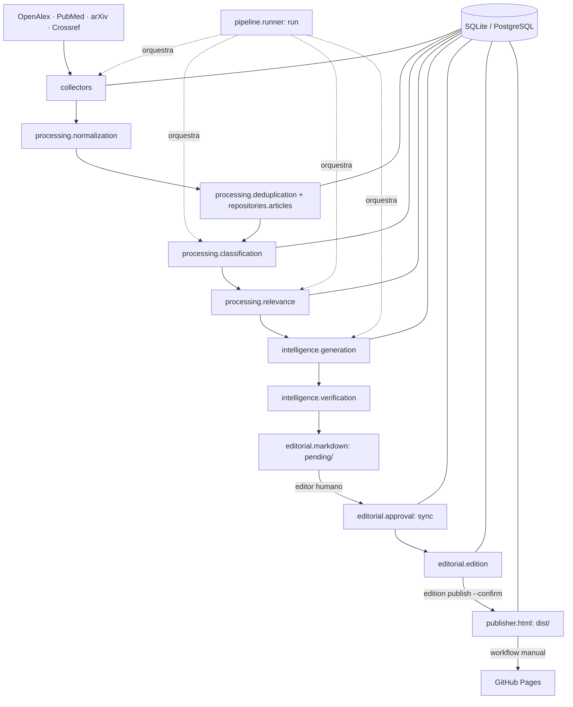

# Arquitetura

## Estilo

**Monólito modular orientado a pipeline** (SPECIFICATION.md, seção 4). Cada estágio é um
pacote com responsabilidade própria e comunica-se com os demais pelo banco de dados e por
interfaces explícitas. Qualquer estágio pode ser reexecutado sem repetir os anteriores (ex.:
gerar nova versão de um rascunho sem coletar novamente).

## Pacotes

| Pacote | Responsabilidade |
|---|---|
| `config` | `Settings` (pydantic-settings) e logging. |
| `domain` | Modelos ORM, enums, esquemas Pydantic (`NormalizedArticle`, editorias). |
| `infrastructure` | Engine, sessões transacionais, migrações Alembic, carga das editorias. |
| `infrastructure.repositories.articles` | Inserção/mesclagem incremental com deduplicação. |
| `collectors` | `BaseCollector.collect(query, start_date, end_date)`, cliente HTTP com retry/backoff/limite, um coletor por fonte, `service` (coleta e enriquecimento Crossref). |
| `processing` | Normalização (DOI, URL, títulos, texto), deduplicação, classificação por regras (`rules/classification.json`) e relevância heurística. |
| `intelligence` | `AIProvider` (mock e OpenAI-compatível), prompts versionados, esquemas de saída, seleção/geração/versões, verificação determinística. |
| `editorial` | Markdown com front matter, validação, sincronização/aprovação, edições. |
| `publisher` | Templates Jinja2, CSS/JS, geração do site e da pré-visualização. |
| `pipeline` | Execução automatizada com trava exclusiva, registro em `pipeline_runs`, relatório. |
| `cli` / `main` | Interface `python -m ufabc_science`. |

## Fluxo de confiança

1. **Dados externos são não confiáveis.** Respostas brutas ficam em `data/raw/`; cada artigo
   guarda `raw_data_path`, `source_metadata` e um `ArticleSource` por fonte.
2. **Revisão por pares só com evidência.** `verified` exige registro em periódico (OpenAlex
   `journal`, Crossref `journal-article`, PubMed `Journal Article`); arXiv é sempre `preprint`
   até outra fonte confirmar. O status só "sobe" e a evidência é registrada.
3. **A IA recebe apenas os dados coletados**, delimitados como dados não confiáveis; não gera
   referência, link nem DOI (montados pelo sistema).
4. **Verificação determinística** sobre o rascunho e, de novo, sobre o texto editado pelo
   humano no momento da aprovação.
5. **Aprovação humana** somente pelo arquivo Markdown, vinculada ao hash do corpo; editar
   depois invalida a aprovação.
6. **Publicação explícita** (`edition publish --confirm`) fixa a revisão aprovada de cada item;
   o site público usa esse texto fixado.
7. **Deploy manual** com frase de confirmação; a automação semanal não tem permissão de Pages.

## Decisões técnicas

| # | Decisão | Motivo |
|---|---|---|
| D1 | Python `>=3.10` (CI em 3.10 e 3.12) | Interpretador disponível no ambiente de desenvolvimento; a spec aceita versão estável compatível. |
| D2 | Raiz do repositório = raiz do projeto | Simplicidade. |
| D3 | CLI com `argparse` | Sem dependência extra; subcomandos aninhados. |
| D4 | Schema somente por migrações Alembic | Fonte única; caminho para PostgreSQL; teste garante modelos = migrações. |
| D5 | Enums como `VARCHAR(32)` (`native_enum=False`) | Portável; adicionar valores não exige migração de tipo. |
| D6 | `UTCDateTime` rejeita datetime sem fuso | SQLite descarta fuso; seção 7.11 exige UTC. |
| D7 | Autores/instituições/palavras-chave em JSON | A spec não define essas entidades. |
| D8 | `PRAGMA foreign_keys=ON` | SQLite não aplica FKs por padrão. |
| D9 | Convenção de nomes de constraints | Migrações determinísticas no modo batch. |
| D10 | `tzdata` | Windows não tem base IANA de fusos. |
| D11 | `docs/SPECIFICATION.md` e `docs/etapa*.md` fora do `ruff format` | O Ruff formata blocos de código em Markdown e alteraria documentos do autor. |
| D12 | Slugs com hífen (`computacao-e-tecnologia`) | Coerentes com o exemplo de front matter da SPECIFICATION (13.1); os nomes da Etapa 3 (`computacao_tecnologia`) são aceitos como aliases. |
| D13 | Enums renomeados conforme Etapas 3–5 (`rule_based`, `ai_assisted`, `needs_revision`, `ready`, `archived`) | Migração `0002` converte valores antigos. |
| D14 | Similaridade de título apenas sinaliza (`possible_duplicate_of_id`) | Seção 8.1: nunca excluir automaticamente por título. |
| D15 | Mesclagem preenche vazios, não sobrescreve | "Não sobrescrever dados melhores com incompletos". |
| D16 | Crossref também como enriquecimento (`enrich`) por DOI, idempotente | Confirmação de publicação de preprints (seção 6.4). |
| D17 | Classificação por regras em JSON configurável; IA só para casos ambíguos, com teto de confiança 0,75 e sempre marcada como incerta | Seção 9 e Etapa 3 §3.2. |
| D18 | Relevância heurística determinística (`heuristic-v2`); prompt de relevância por IA versionado, mas não usado por padrão | Funciona sem IA; sem citações/fator de impacto/prestígio. |
| D33 | Classificação `rules-v2`: categoria secundária só com confiança ≥ 60% da principal; máximo de 3 editorias (configuráveis no JSON) | Teste com 368 artigos reais: termos genéricos atribuíam até 5 editorias e inflavam a interdisciplinaridade. |
| D34 | `heuristic-v2`: abstract com mais de 600 palavras não recebe bônus de detalhamento; depósito em repositório genérico sem triagem (Zenodo, OSF, Figshare…) recebe −15 em relevância científica, com justificativa. Servidores de preprint moderados (arXiv, bioRxiv…) não são afetados | Itens sem triagem e "abstracts" com texto completo ocupavam o topo da lista. Não é critério de prestígio institucional; é ausência de triagem editorial. **Decisão a revisar pelo responsável editorial.** |
| D35 | Mudança de versão das regras ou do método reprocessa automaticamente (histórico preservado; categorias manuais mantidas) | Evita misturar critérios antigos e novos. |
| D19 | `AIProvider.generate_structured(prompt, schema)`; adaptador único **OpenAI-compatível** | Cobre provedores locais gratuitos (Ollama, LM Studio) e serviços hospedados sem acoplamento. |
| D20 | Referência, título original e link montados pelo sistema | Elimina referências/DOIs inventados pela IA. |
| D21 | Hash de entrada = dados + versão do prompt + limites | Evita regenerar sem necessidade; mudança de prompt gera nova versão. |
| D22 | Artigos sem abstract suficiente não vão à IA (aviso de insuficiência registrado na seleção) | Seção 11.2. |
| D23 | Verificação de afirmações lexical (números + termos compartilhados) | Determinística; não usa outra chamada à mesma IA (Etapa 3 §10). |
| D24 | Um arquivo ativo por artigo; versões antigas e propostas em `data/editorial/history/` | Não sobrescrever edição manual; preservar versões. |
| D25 | Ordem do histórico editorial pela inserção (id), não por `reviewed_at` | `reviewed_at` é informado pelo editor e pode coincidir/regredir. |
| D26 | Introdução da edição em `editions/drafts/<slug>.md` com aprovação própria | Etapa 4 §6.3. |
| D27 | Publicação fixa `review_id` por item e grava `editions/published/<slug>.json` | Auditável; o site não muda se o Markdown for editado depois. |
| D28 | Pré-visualização em `build/preview/` com `noindex`; site público em `dist/` | Gerar HTML ≠ publicar. |
| D29 | `nh3` para sanitizar HTML do Markdown; autoescape do Jinja2 | Segurança (Etapa 4 §8). |
| D30 | Persistência: branch dedicada `data` (Alternativa A) | Ver `PERSISTENCE_STRATEGY.md`. |
| D31 | Trava por arquivo + verificação de `RUNNING` + `concurrency` no workflow | Proteção contra execuções simultâneas. |
| D32 | Actions fixadas por SHA de commit | Controle de versões (Etapa 5 §6). |
