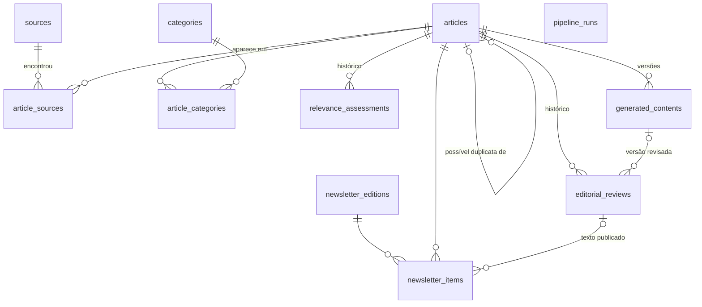

# Banco de dados

Modelos: `src/ufabc_science/domain/models.py` · Migrações:
`src/ufabc_science/infrastructure/migrations/versions/` · Revisão atual: **`0002`**.

| Revisão | Conteúdo |
|---|---|
| `0001` | Entidades da seção 7 (Etapa 1). |
| `0002` | Campos das Etapas 2–5, tabela `pipeline_runs`, `server_default` para colunas novas e conversão de valores de enum renomeados. |

## Diagrama

## Tabelas

### `articles`
| Coluna | Regras |
|---|---|
| `title` | obrigatório |
| `abstract` | texto limpo (sem JATS/HTML) |
| `doi` | normalizado (`10.xxxx/...`, minúsculas), **único** quando presente |
| `external_id` | identificador principal `<fonte>:<id>` (índice) |
| `canonical_url` | URL normalizada para deduplicação (índice) |
| `publication_date`, `collected_at` | índices; `collected_at` em UTC |
| `journal`, `publisher`, `language`, `open_access` | `open_access = NULL` significa desconhecido |
| `authors` | JSON `[{"name", "orcid"?, "affiliations"?: [...]}]` (e-mails removidos) |
| `institutions` | JSON `[{"name", "ror"?, "country"?}]` |
| `keywords` | JSON: palavras-chave, MeSH, conceitos/tópicos e categorias das fontes |
| `article_type` | `journal_article`, `preprint`, `review`, `conference_paper`, `book_chapter`, `other`, `unknown` |
| `peer_review_status` | `verified` (publicação em periódico confirmada por metadados), `preprint`, `unknown` (padrão). Só "sobe" com evidência, registrada em `source_metadata.peer_review_evidence`. |
| `source_metadata` | metadados originais por fonte; `crossref_lookup` marca enriquecimento já feito |
| `raw_data_path` | resposta bruta em `data/raw/<fonte>/<data>/` |
| `possible_duplicate_of_id`, `duplicate_reason` | título muito similar a outro registro: **sinalizado, nunca mesclado** |

### `sources` / `article_sources`
`sources(name único, base_url, source_type api|feed, active)`. `article_sources` liga cada
artigo a cada fonte em que foi encontrado; **único `(source_id, external_id)`** — base da
coleta idempotente.

### `categories` / `article_categories`
Cinco editorias (slugs `neurociencia`, `computacao-e-tecnologia`, `engenharias`,
`ciencias-biologicas`, `ciencias-e-stem`). `article_categories`: PK `(article_id,
category_id)`, `confidence` (CHECK 0–1), `classification_method` (`rule_based`,
`ai_assisted`, `manual`), `justification`, `is_uncertain`, `classified_at`. Reclassificação
nunca remove categorias `manual`.

### `relevance_assessments`
Cinco critérios inteiros (CHECK 0–100), `final_score` (CHECK 0–100, índice),
`justification` (JSON por critério), `method_version` (ex.: `heuristic-v2`), `assessed_at`.
Histórico preservado; a avaliação vigente é a de maior `id`.

### `generated_contents`
Uma linha por versão (**único `(article_id, version)`**): seções do texto, `original_title`,
`reference` e `source_url` (montados pelo sistema), `uncertainty_notes`, `study_type`,
`model_provider`, `model_name`, `prompt_version`, `input_hash` (SHA-256 de dados + prompt +
limites), `usage` (tokens/tentativas), `verification_status` (`passed`, `warning`, `failed`),
`verification_report` (checagens e afirmações), `verified_at`, `generated_at`.

### `editorial_reviews`
Histórico de decisões humanas: `status` (`pending_review`, `approved`, `rejected`,
`needs_revision`), `reviewer`, `comments`, `warning_justification`, `content_hash` (SHA-256 do
corpo revisado), `content_snapshot` (texto aprovado), `file_path`, `generated_content_id`,
`reviewed_at`. O estado vigente é a revisão de maior `id`.

### `newsletter_editions` / `newsletter_items`
Edição: `edition_number` e `slug` únicos, `week` ISO único, período (CHECK
`end_date >= start_date`), `status` (`draft`, `ready`, `published`, `archived`),
`introduction` + `introduction_status`/`reviewer`/`reviewed_at`, `published_at`,
`published_by`. Itens: `position` (único por edição, ≥ 1), `editorial_section` (editoria
principal), `review_id` (revisão aprovada fixada na publicação). Único `(edition_id,
article_id)`: um artigo aparece uma vez por edição.

### `pipeline_runs`
`id` (12 hex), `trigger`, `status` (`running`, `success`, `partial_success`, `failed`),
`started_at`, `finished_at`, `duration_seconds`, `parameters`, `stats`, `errors`, `messages`.

## Regras transversais

- **UTC** no armazenamento (`UTCDateTime` rejeita datetime sem fuso); conversão para
  `America/Sao_Paulo` apenas na apresentação.
- **Sem exclusão automática**: rejeição não remove artigos; `generated_contents` e
  `editorial_reviews` não têm cascata (FK impede apagar artigo com histórico).
- **Transações**: `session_scope()`; a coleta usa uma transação por fonte e a geração uma por
  artigo.
- **JSON**: atribua um novo objeto ao alterar; mutações em lugar não são rastreadas.

## Portabilidade para PostgreSQL

Somente tipos genéricos (JSON, Enum não nativo, DateTime com fuso). Instale um driver
(`psycopg`), ajuste `DATABASE_URL` e execute `init-db`. Não validado em produção.

## Evolução do schema

1. Altere os modelos.
2. `alembic revision --autogenerate -m "..."` e **revise** (adicione `server_default` em
   colunas NOT NULL novas).
3. `pytest tests/integration/test_database_init.py` (modelos = migrações; downgrade).
