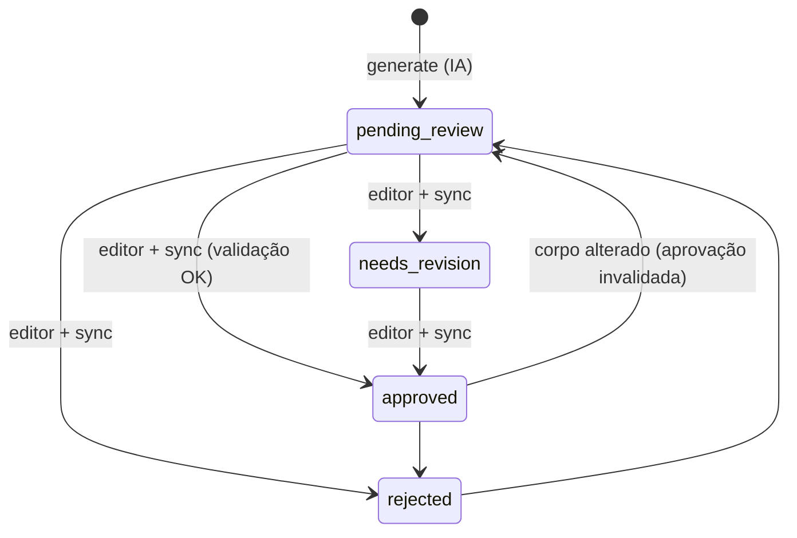

# Fluxo editorial

O Markdown é a interface entre a automação e o editor humano. Não há painel administrativo.



## 1. Onde ficam os rascunhos

```text
data/editorial/
├── pending/     article-<id>.md  (pending_review e needs_revision)
├── approved/    article-<id>.md
├── rejected/    article-<id>.md
└── history/     versões anteriores e novas versões propostas (nunca lidas como ativas)
```

```bash
python -m ufabc_science editorial list               # pendentes
python -m ufabc_science editorial list --status all
```

## 2. Estrutura do arquivo

```markdown
---
schema: ufabc-science/article@1      # identifica arquivos do projeto (não alterar)
article_id: 13                        # não alterar
content_id: 7                         # versão do rascunho (não alterar)
content_version: 1
status: pending_review                # pending_review | approved | rejected | needs_revision
categories: [computacao-e-tecnologia, engenharias]
primary_category: engenharias         # editoria em que o artigo aparece na edição
source_url: https://arxiv.org/abs/2611.10498
doi: null
peer_review_status: preprint          # vem do registro; não alterar
verification_status: warning
verification_messages: [...]          # avisos da verificação automática: LEIA
reviewer: null                        # opcional
reviewed_at: null                     # preenchido na aprovação, se vazio
editorial_notes: null                 # comentários (registrados no histórico)
warning_justification: null           # obrigatório para aprovar conteúdo com WARNING
edition_slug: null
---

# Título editorial

## Introdução
## Contexto científico
## O que foi investigado?
## Como a pesquisa foi realizada?
## Principais resultados
## Limitações
## Por que isso importa?
## Referência

[Consultar pesquisa original](https://...)
```

Edite livremente o **texto** das seções. Mantenha os títulos `##` (seções desconhecidas geram
aviso e não são publicadas) e a seção Referência com o link.

## 3. Como interpretar a verificação

| Estado | Significado | Efeito |
|---|---|---|
| `PASSED` | Nenhuma inconsistência detectada pelas regras. | Pode ser aprovado. |
| `WARNING` | Pontos que exigem atenção (sem DOI, **fonte atípica** — repositório sem triagem ou abstract anormal —, texto mais longo que a referência, afirmações sem evidência vinculável, linguagem sensacionalista, notas do gerador). Texto curto não gera aviso: não se aumenta texto artificialmente. | Aprovação exige `warning_justification`. |
| `FAILED` | Inconsistência crítica: números ausentes da fonte, DOI/link/autores/citações que não pertencem ao registro, preprint não identificado, revisão por pares não confirmada, aconselhamento clínico, título divergente, informação insuficiente. | **Aprovação bloqueada** até o texto ser corrigido. |

A verificação é refeita **sobre o texto editado** a cada `sync`/`validate`: corrigir o texto
pode transformar um `FAILED` em aprovável. Ela não comprova a veracidade científica.

## 4. Aprovar, rejeitar ou pedir revisão

1. Leia o rascunho, o abstract original (link) e `verification_messages`.
2. Corrija o texto. Confira números, unidades, limitações e o rótulo de preprint.
3. No front matter:
   - aprovar: `status: approved` (+ `warning_justification` se houver WARNING, `reviewer`);
   - rejeitar: `status: rejected` (+ `editorial_notes`);
   - pedir revisão: `status: needs_revision` (+ `editorial_notes`).
4. Sincronize:

   ```bash
   python -m ufabc_science editorial validate      # só verifica, não altera nada
   python -m ufabc_science editorial sync --dry-run
   python -m ufabc_science editorial sync
   ```

`sync` registra uma `EditorialReview` (com hash e cópia do texto aprovado), move o arquivo para
a pasta do estado e informa erros por arquivo. Rejeição nunca apaga o artigo.

## 5. Alterações depois da aprovação

Se o corpo de um arquivo aprovado mudar, o próximo `sync` **invalida a aprovação**: registra
`pending_review` com a nota "aprovação invalidada", devolve o arquivo para `pending/` e o
artigo deixa de poder entrar em edições. Para aprovar de novo, defina `status: approved`.
Mudanças só no front matter (ex.: `reviewer`) não invalidam.

## 6. Gerar novamente um rascunho

```bash
python -m ufabc_science generate --article-id 13            # só se dados/prompt mudaram
python -m ufabc_science generate --article-id 13 --force    # força nova versão
```

- Sem mudanças nos dados ou no prompt, nada é gerado (hash de entrada igual).
- Se o arquivo atual foi editado ou já revisado, ele **não é sobrescrito**: a nova versão é
  salva em `history/article-<id>.v<N>.proposed.md`.
- Com `--force`, o arquivo atual é arquivado em `history/article-<id>.v<N>.md` e substituído.
- Todas as versões ficam em `generated_contents`.

## 7. Garantias

- Nenhum código aprova conteúdo; `run`, `process` e `generate` sempre escrevem `pending_review`.
- O estado do banco é revalidado contra o arquivo no momento da edição e da publicação.
- Arquivos duplicados para o mesmo artigo, sem `schema` do projeto ou com `article_id`
  inexistente são reportados como erro e ignorados.
